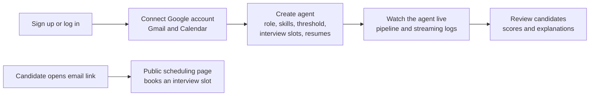

# AutoHire — Frontend (Recruiter Dashboard)

AutoHire is an **autonomous AI recruitment agent**. A recruiter describes a role and uploads resumes, and the agent screens them with an LLM, scores each candidate against the job description, emails the best matches, and lets them book an interview, which is created in Google Calendar with a Google Meet link.

This repository contains the **web dashboard**, built with Next.js 16, React 19, and TypeScript.
The AI pipeline, API, and background worker live in the backend repository: **[server.autohire](https://github.com/ahadali0500/server.autohire)**. That README explains the AI design in detail.

---

## What the Dashboard Does



### Features

- **Agent creation wizard:** define the job title, description, must-have and nice-to-have skills (tag input), minimum experience, maximum candidates, minimum resume score, and interview availability (dates and time slots), then upload resumes.
- **Direct-to-S3 uploads:** resumes are uploaded straight from the browser to AWS S3 using pre-signed URLs from the API. Large files never pass through the backend.
- **Live agent pipeline:** the agent detail page joins a Socket.IO room for that agent and shows each phase (*Resume Screening → Shortlisting → Outreach → Interview Scheduling → Summary*) along with a real-time log of every step the agent takes.
- **Candidate insights:** parsed resume data, per-category AI scores with explanations, outreach status, and interview details including the Meet link.
- **Public interview scheduling:** a page without login (`/schedule/[candidate_id]`) where a shortlisted candidate picks a free slot. This triggers the Calendar event and the confirmation email on the backend.
- **Google integration settings:** the recruiter connects their own Google account through OAuth, so outreach emails and invites are sent from their own address.
- **Authentication:** JWT-based sign-up and sign-in, with the session persisted through Redux Persist and protected routes behind a shared layout.
- **Light / dark theme** and a responsive layout.

---

## Tech Stack

| Concern | Technology |
|---|---|
| Framework | Next.js 16 (App Router), React 19, TypeScript |
| Styling / UI | Tailwind CSS 4, Ant Design 6, Radix UI, lucide-react |
| State management | Redux Toolkit + Redux Persist (auth, agent, UI state) |
| Server state | TanStack React Query |
| Forms & validation | React Hook Form + Zod |
| HTTP | Axios |
| Real-time | socket.io-client |

---

## Project Structure

```
src/
├── app/
│   ├── (auth)/                 # signin, signup
│   ├── (protected)/            # requires login
│   │   ├── dashboard/          # overview
│   │   └── agent/
│   │       ├── page.tsx        # list of agents
│   │       ├── new/            # agent creation wizard + availability setup
│   │       ├── [slug]/         # live agent pipeline, logs, candidates
│   │       └── setting/        # Google integration and agent settings
│   ├── (public)/
│   │   ├── schedule/[candidate_id]/   # candidate-facing interview booking
│   │   ├── how-it-work/  pricing/  about-us/  contact/
│   └── page.tsx                # landing page
├── components/                 # layout (sidebar, top bar, theme toggle), inputs
├── hooks/                      # React Query hooks (agents, auth, dashboard)
├── lib/
│   ├── api.ts                  # Axios client + API functions
│   ├── socket.ts               # Socket.IO client
│   └── validations.ts          # Zod schemas
├── store/                      # Redux slices (auth, agent, ui)
└── types/                      # shared TypeScript types
```

---

## Getting Started

### Prerequisites

- Node.js 20+
- The [AutoHire backend](https://github.com/ahadali0500/server.autohire) running locally (by default on port `8002`), along with its PostgreSQL, Redis, and Celery worker

### 1. Install

```bash
git clone https://github.com/ahadali0500/client.autohire.git
cd client.autohire
npm install
```

### 2. Configure environment

```bash
cp .env.example .env
```

| Variable | Description |
|---|---|
| `NEXT_PUBLIC_API_BASE_URL` | URL of the backend API and Socket.IO server, e.g. `http://127.0.0.1:8002` |

> This value is exposed to the browser (`NEXT_PUBLIC_`). Never put secrets in frontend environment variables.

### 3. Run

```bash
npm run dev       # development server on http://localhost:3000
npm run build     # production build
npm run start     # serve the production build
npm run lint      # ESLint
```

### First run

1. Open `http://localhost:3000` and **sign up**.
2. Go to **Agent → Settings → Email Integration**, then add your Google OAuth client credentials and connect your Google account.
3. Create a **new agent**, add the job details and interview slots, and upload a few PDF resumes.
4. Open the agent to watch it screen, score, and contact candidates live.

---

## Author

**Ahad Ali** — [GitHub](https://github.com/ahadali0500)
